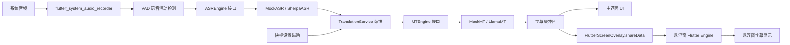

# 实时翻译

基于系统内录的端侧实时字幕应用，支持英日互译，悬浮窗显示翻译结果，快捷设置磁贴一键开关。

## 核心特性

- **模块化引擎架构**：ASR（语音识别）与 MT（机器翻译）完全解耦，通过统一接口动态切换引擎
- **端侧离线推理**：支持 Sherpa-ONNX 流式 ASR 与 llama.cpp GGUF MT 模型，无需联网，保护隐私
- **系统内录音频捕获**：通过 `flutter_system_audio_recorder` 捕获手机系统内其他应用的音频（无需 Root）
- **悬浮窗字幕显示**：独立 Flutter 引擎渲染，支持字号/位置/透明度实时调节，100ms 防抖节流避免高频渲染崩溃
- **快捷设置磁贴**：一键开启/关闭翻译服务，Android 15 兼容，权限缺失时高优先级通知引导
- **Mock 先行开发**：完整的 Mock ASR/MT 链路，无模型文件即可跑通全流程验证 UI 与架构

## 架构设计



### 核心模块

| 模块 | 职责 | 关键技术 |
|------|------|----------|
| `ASREngine` | 音频流 → 文本流接口 | 策略模式，支持流式/非流式 |
| `MTEngine` | 源语言 → 目标语言翻译接口 | 支持流式分片输出 |
| `EngineManager` | 引擎注册/实例化/切换/销毁 | 单例，工厂模式，生命周期管理 |
| `TranslationService` | 编排 ASR→MT，字幕缓冲，防抖发送 | Provider 状态管理，100ms 节流 |
| `QuickSettingsTileService` | 系统磁贴绑定，权限检查，状态同步 | MethodChannel + 原生 TileService |
| `OverlayScreen` | 独立 Flutter Engine，悬浮窗渲染 | `@pragma('vm:entry-point')` 入口 |

## 快速开始

### 环境要求

- Flutter 3.44+ / Dart 3.12+
- Android minSdk 29 (Android 10)
- JDK 17 (构建环境)

### 本地编译

```bash
# 1. 克隆仓库
git clone https://github.com/your-org/live_translate.git
cd live_translate

# 2. 获取依赖
flutter pub get

# 3. 代码分析
flutter analyze

# 4. 运行测试
flutter test

# 5. 构建 Release APK (分 ABI 减小体积)
flutter build apk --release --split-per-abi

# 产物位置: build/app/outputs/flutter-apk/
```

### 从 Release 下载

前往 [GitHub Releases](https://github.com/your-org/live_translate/releases) 下载最新版本 APK：
- `app-release.apk` - 通用包 (含所有 ABI)
- `app-arm64-v8a-release.apk` - 现代 64 位 ARM 设备 (推荐)
- `app-armeabi-v7a-release.apk` - 旧 32 位 ARM 设备
- `app-x86_64-release.apk` - 模拟器/ x86 设备

### 安装与配置

1. 安装 APK，打开应用
2. 授予权限：**录音**、**悬浮窗显示**、**通知**
3. 下拉通知栏 → 编辑快捷设置 → 添加「实时翻译」磁贴
4. 点击磁贴或应用内发光蓝色按钮开始翻译
5. 悬浮窗会显示在所有应用上层，支持拖拽、字号调节、位置切换

## 如何扩展模型

### 新增 ASR 引擎

```dart
// 1. 实现 ASREngine 接口
class MyCustomASR implements ASREngine {
  @override String get engineId => 'my_asr';
  @override String get displayName => 'My Custom ASR';
  
  @override bool isInitialized = false;
  @override bool isRunning = false;
  @override String currentLanguage = 'en';
  @override List<String> get supportedLanguages => ['en', 'zh'];
  
  @override Future<void> initialize({...}) async { /* 加载模型 */ }
  @override Future<void> start({required onResult, required onError}) async { /* 启动识别 */ }
  @override Future<void> stop() async { /* 停止 */ }
  @override Future<void> pushAudio(List<int> audioData) async { /* 推流 */ }
  @override Future<void> switchLanguage(String lang) async { /* 切语言 */ }
  @override Future<void> dispose() async { /* 释放 */ }
  @override Map<String, dynamic> getStatus() => {...}
}

// 2. 在 EngineManager 注册
EngineManager().registerASREngine('my_asr', () => MyCustomASR());

// 3. 切换使用
await translationService.switchASREngine('my_asr', config: {'modelPath': '...'});
```

### 新增 MT 引擎

```dart
// 1. 实现 MTEngine 接口
class MyCustomMT implements MTEngine {
  @override String get engineId => 'my_mt';
  @override String get displayName => 'My Custom MT';
  
  @override bool isInitialized = false;
  @override bool isRunning = false;
  @override String sourceLanguage = 'en';
  @override String targetLanguage = 'ja';
  @override List<LanguagePair> get supportedLanguagePairs => [...];
  
  @override Future<void> initialize({...}) async { /* 加载模型 */ }
  @override Future<void> translateStream({...}) async { /* 流式翻译 */ }
  @override Future<MTResult> translate(String text) async { /* 单次翻译 */ }
  @override Future<void> switchLanguagePair(String src, String tgt) async { /* 切语言对 */ }
  @override Future<void> dispose() async { /* 释放 */ }
  @override Map<String, dynamic> getStatus() => {...}
}

// 2. 注册并切换
EngineManager().registerMTEngine('my_mt', () => MyCustomMT());
await translationService.switchMTEngine('my_mt', config: {'modelPath': '...'});
```

### 云端引擎接入示例

云端引擎只需在 `pushAudio`/`translateStream` 中发起 HTTP 请求，无需本地模型文件，适合网络良好场景。

## 免责声明

### 隐私合规

- **完全离线**：核心 ASR/MT 推理在设备本地运行，音频与文本**绝不上传**任何服务器
- **系统内录**：仅捕获用户授权的系统音频流，不访问麦克风、通话录音或文件系统
- **无账号体系**：应用不收集任何个人身份信息、设备标识符或使用统计
- **权限最小化**：仅申请 `RECORD_AUDIO`、`SYSTEM_ALERT_WINDOW`、`POST_NOTIFICATIONS`、`FOREGROUND_SERVICE` 等必要权限

### 使用限制

- 仅供个人学习、研究、辅助沟通使用
- 翻译结果仅供参考，不保证准确性，不得用于法律、医疗、金融等专业决策
- 使用者需遵守当地法律法规，不得用于侵犯他人隐私、窃取商业机密等非法用途
- 开发者不承担因翻译错误、服务中断、数据泄露等导致的任何直接或间接损失

### 开源协议

本项目采用 MIT 协议开源，代码仅供参考学习，商用请自行评估合规风险。

---

## 开发路线图

- [x] **阶段 1**：工程初始化、Mock 链路、深色 UI、悬浮窗、磁贴
- [ ] **阶段 2**：音频内录 + VAD 调度 (16kHz PCM 流切片)
- [ ] **阶段 3**：Sherpa-ONNX ASR + llama.cpp MT 真实模型接入
- [ ] **阶段 4**：GitHub Actions 自动化构建发布 (已完成 Workflow)

## 目录结构

```
lib/
├── core/
│   ├── engine/          # 引擎接口、管理器、Mock 实现
│   │   ├── asr_engine.dart
│   │   ├── mt_engine.dart
│   │   ├── engine_manager.dart
│   │   ├── mock_asr.dart
│   │   └── mock_mt.dart
│   ├── service/         # 业务编排服务
│   │   └── translation_service.dart
│   └── tile/            # 快捷设置磁贴
│       └── quick_settings_tile.dart
├── ui/
│   ├── main_screen.dart # 主界面
│   └── overlay_screen.dart # 悬浮窗界面 (独立 Entry Point)
└── main.dart            # 应用入口
```

## 贡献指南

1. Fork 仓库并创建特性分支
2. 遵循 `flutter analyze` 与 `dart format` 规范
3. 新增引擎请同时提供 Mock 实现便于 CI 验证
4. 提交 PR 前确保 `flutter test` 通过

## 许可证

MIT License - 详见 [LICENSE](LICENSE) 文件
